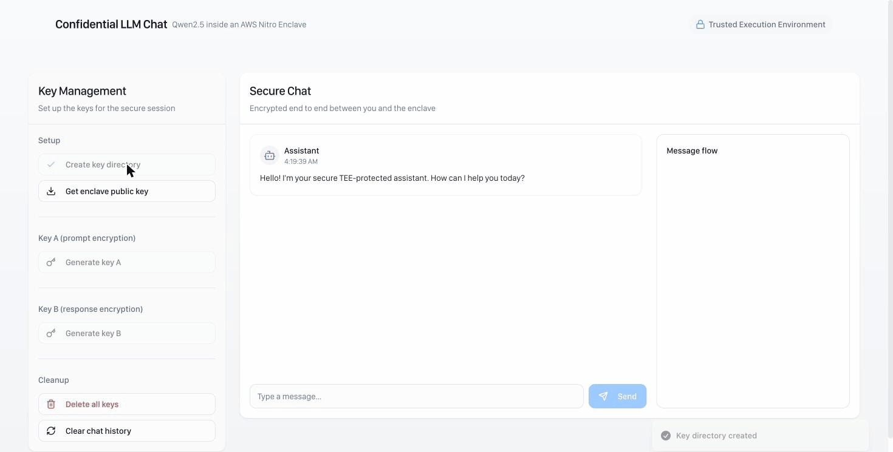
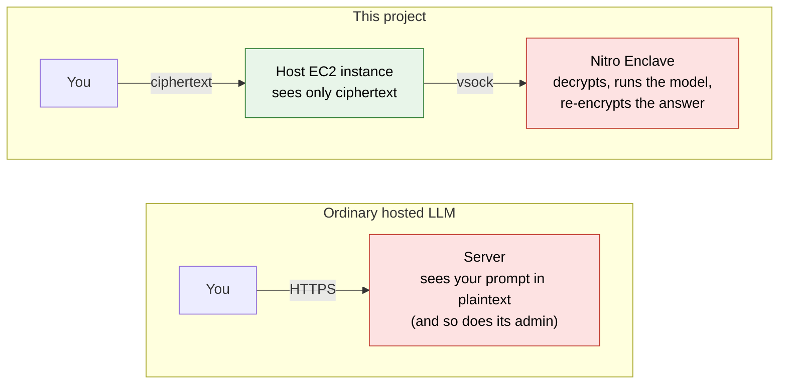
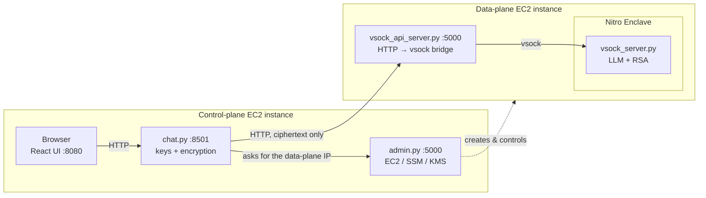
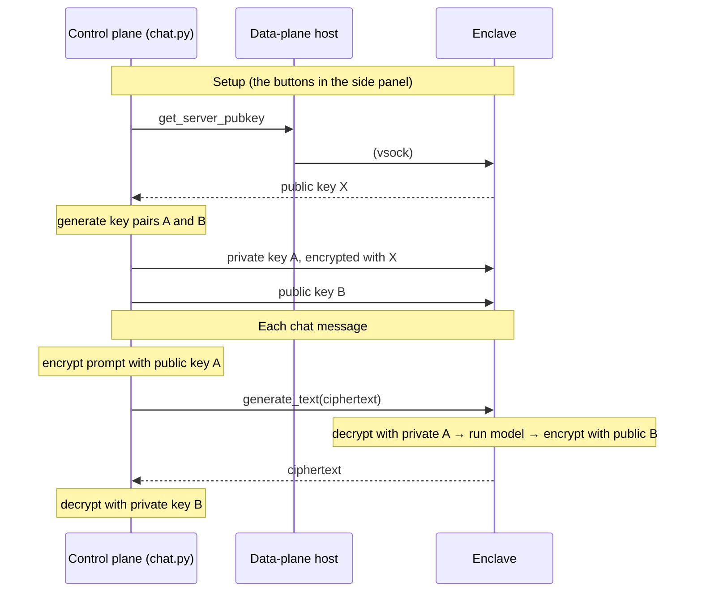

# Confidential LLM on AWS Nitro Enclaves

A chat app where the language model runs inside an **AWS Nitro Enclave**, a sealed-off part of a server that even the server's own administrator cannot look into. Your prompt is encrypted before it leaves the control plane and is only ever decrypted inside the enclave; the answer comes back the same way. The machine that hosts the model only ever sees ciphertext.

Default model: [Qwen2.5-0.5B-Instruct](https://huggingface.co/Qwen/Qwen2.5-0.5B-Instruct). The original prototype used GPT-2, which is still supported ([Model](#model)).



**Contents:** [The problem](#the-problem-this-solves) · [How it works](#how-it-works-in-one-minute) · [Architecture](#architecture) · [Keys](#the-keys-and-who-holds-them) · [Run locally](#run-it-locally-no-aws-needed) · [Deploy on AWS](#deploy-on-aws) · [Model](#model) · [Security & limitations](#security-model-and-known-limitations) · [Glossary](#glossary)

## The problem this solves

When you send a question to a hosted LLM, the company running the server can read it. Encryption "in transit" (HTTPS) protects the network hop, but the text is decrypted the moment it reaches the server, because the model needs plaintext to work on. Anyone with root access to that machine, or a compromised process on it, can read every prompt.

A **Trusted Execution Environment (TEE)** changes that. The model runs inside an isolated area whose memory is encrypted and which the host operating system cannot read or debug. On AWS this is a **Nitro Enclave**: a stripped-down VM carved out of an EC2 instance, with no network, no disk and no login, reachable only through a narrow local channel called **vsock**.



Red = plaintext exists here. In this project the only place the prompt is readable on the server side is inside the enclave.

## How it works in one minute

There are three machines (or, locally, three containers):

| | Name | Role | Can it read your prompt? |
|---|---|---|---|
| 1 | **Control plane** | The machine you talk to. Runs the chat website, creates the encryption keys, encrypts your prompt and decrypts the answer. | Yes, it is on your side of the trust boundary |
| 2 | **Data plane** | The EC2 host that owns the enclave. Only relays encrypted bytes into and out of the enclave. | **No** |
| 3 | **Enclave** | Runs inside the data plane. Holds the model, decrypts the prompt, generates, encrypts the answer. | Yes, but nothing outside it can see in |

Sending one message looks like this:

```mermaid
flowchart LR
    classDef plain fill:#fde2e2,stroke:#c0392b,color:#000
    classDef cipher fill:#e8f5e9,stroke:#2e7d32,color:#000
    classDef enc fill:#fff8e1,stroke:#f9a825,color:#000

    P["1. Your prompt<br/>(plaintext)"]:::plain --> E1["2. Encrypt with<br/>public key A"]:::enc
    E1 --> C1["3. Ciphertext travels<br/>through the data plane"]:::cipher
    C1 --> D1["4. Enclave decrypts<br/>with private key A"]:::plain
    D1 --> G["5. Model generates<br/>the answer"]:::plain
    G --> E2["6. Enclave encrypts<br/>with public key B"]:::enc
    E2 --> C2["7. Ciphertext travels<br/>back out"]:::cipher
    C2 --> D2["8. Control plane decrypts<br/>with private key B"]:::plain
```



The chat UI shows exactly these steps live in its "Message flow" panel, and prints the ciphertext of both the prompt and the answer so you can see that what crosses the data plane is unreadable.

## Architecture



| Directory | Runs on | What it does |
|---|---|---|
| [`enclave/`](enclave/) | Inside the Nitro Enclave | `vsock_server.py` loads the model and answers four requests: `get_server_pubkey`, `send_encrypted_client_seckey_a`, `send_client_pubkey_b`, `generate_text`. `Dockerfile` becomes the enclave image (`.eif`). |
| [`data-plane/`](data-plane/) | Parent EC2 instance | `vsock_api_server.py` exposes those four requests over HTTP; `vsock_client.py` finds the enclave's address with `nitro-cli` and talks vsock. |
| [`control-plane/api/`](control-plane/api/) | Control-plane EC2 instance | `admin.py`: create / start / stop / delete the data-plane instance, launch the enclave, create a KMS key, start the demo. `chat.py`: generate keys, encrypt, decrypt, forward to the data plane. |
| [`control-plane/web/`](control-plane/web/) | Control-plane EC2 instance | React + Vite + shadcn/ui chat UI with the key-setup panel and the live message-flow view. |
| [`docker-compose.yml`](docker-compose.yml), [`scripts/`](scripts/) | Your laptop | Local mock mode and an end-to-end smoke test. |

## The keys, and who holds them

Everything is RSA-2048 with OAEP/SHA-256 (PyCryptodome). Three key pairs are involved. The enclave makes one; the control plane makes two and hands the enclave exactly the halves it needs.

| Key | Made by | Public half goes to | Private half stays with | Used for |
|---|---|---|---|---|
| **X** (enclave key) | Enclave, fresh each session | Control plane | Enclave | Wrapping private key A so it can be delivered safely |
| **A** (prompt key) | Control plane | Stays on control plane (encrypts prompts) | Sent to the **enclave**, encrypted with X | Prompt: control plane locks, enclave unlocks |
| **B** (response key) | Control plane | Sent to the **enclave** in the clear | Control plane | Answer: enclave locks, control plane unlocks |



Why can the data plane not cheat? It never holds private key A (it only forwards it wrapped under X, and only the enclave has X's private half) and never holds private key B. Everything it sees is locked with a key it does not have.

## Run it locally (no AWS needed)

```sh
docker compose up --build        # first build downloads CPU torch + Qwen2.5-0.5B-Instruct (~1 GB), a few minutes
open http://localhost:8080       # click the key-setup buttons top to bottom, then chat
python scripts/smoke_test.py     # or drive the whole flow from the terminal
```

Local mode runs the **same `vsock_server.py`** as a plain container, with `ENCLAVE_TRANSPORT=tcp` instead of vsock. The key exchange and encryption are identical to the Nitro deployment; what's missing is the hardware isolation and attestation. The enclave and data-plane containers aren't published to the host, so the browser only ever reaches `chat.py`, as in production.

`scripts/smoke_test.py` runs the key exchange and one encrypted chat turn against `chat.py`, and exits non-zero on any failure:

```
[ok] create key directory
[ok] get enclave public key
[ok] generate key A
[ok] generate key B
[ok] encrypt private key A with enclave key
[ok] send encrypted key A to enclave
[ok] send public key B to enclave
[ok] encrypt prompt with key A
      ciphertext: G3KQ2ZJb5wzA6MW7be4QRltwucPkYzpDvA0jXeMfvO/gUYAH...
[ok] generate text inside enclave
[ok] decrypt response with key B

prompt:   In two sentences, what is a trusted execution environment?
response: A trusted execution environment ensures that software runs as intended and meets security standards.
```

To see that the host really only relays ciphertext, compare the logs: `docker compose logs enclave` prints the decrypted prompt; `docker compose logs data-plane` shows only HTTP requests.

## Deploy on AWS

You need an AWS account. Nitro Enclaves require a supported instance type (for example `m5.xlarge` or larger) with the enclave option turned on.

### 1. Data plane: build the enclave image

On an Amazon Linux 2023 EC2 instance with Nitro Enclaves enabled:

```sh
bash data-plane/scripts/ec2-setup.sh            # nitro-cli + docker groups (log out/in afterwards)
python3 -m venv ~/venv && source ~/venv/bin/activate
pip install -r enclave/requirements.txt -r data-plane/requirements.txt

cd enclave
python download_model.py                        # Qwen2.5-0.5B-Instruct; or: python download_model.py gpt2
docker build -t llm-enclave .
nitro-cli build-enclave --docker-uri llm-enclave:latest --output-file llm.eif    # note PCR0-2
```

### 2. Control plane

```sh
cp .env.example .env                            # fill in your own AWS values
set -a; source .env; set +a

pip install -r control-plane/api/requirements.txt
python control-plane/api/admin.py               # admin UI on :5000

cd control-plane/web && cp .env.example .env && npm ci
```

Then open the admin UI and go through **Create instance → Start TEE → Start demo**. Starting the demo launches `vsock_api_server.py` on the data plane through SSM, and starts `chat.py` and the React dev server locally.

All configuration is read from environment variables; [`.env.example`](.env.example) lists them.

## Model

The enclave loads whatever Hugging Face causal LM is in `MODEL_DIR` (see [`enclave/download_model.py`](enclave/download_model.py)). Instruction-tuned models are prompted through their chat template; base models such as GPT-2 are run as plain text continuation, so both work with the same server.

| Model | Params | Download | Notes |
|---|---|---|---|
| `Qwen/Qwen2.5-0.5B-Instruct` (default) | 0.5B | ~1 GB | Chat-tuned, Apache-2.0, answers questions properly |
| `HuggingFaceTB/SmolLM2-360M-Instruct` | 360M | ~720 MB | Smaller chat model |
| `distilgpt2` / `gpt2` | 82M / 124M | ~350 / ~550 MB | The original prototype's base model; continues text rather than answering |

```sh
ENCLAVE_MODEL=distilgpt2 docker compose up --build        # local mock with the original GPT-2
python enclave/download_model.py gpt2                     # Nitro build with GPT-2
```

`MAX_NEW_TOKENS` (default 150) and `SYSTEM_PROMPT` tune generation. Replies from the 0.5B model take roughly 5–20 s on a laptop CPU. It is a small model: answers are coherent but can be shallow or wrong; the point of the demo is the confidentiality pipeline, not the model.

## Security model and known limitations

What this demo protects against: the **data-plane host OS and whoever administers it** never see prompts or responses in plaintext. Only the enclave can decrypt them.

What it does not protect against, and what I would change next:

- **Plaintext exists on the control plane.** `chat.py` holds both private keys and does the encryption and decryption, and the browser sends plaintext to it. Moving key generation and encryption into the browser (WebCrypto) would make it truly client-to-enclave.
- **Unusual use of key A.** The prompt is encrypted with public key A, and the enclave gets private key A. A simpler and more conventional design: send the enclave an ephemeral AES-GCM session key, wrapped with the enclave's RSA key.
- **No attestation verification yet.** The client trusts whatever public key the data plane returns. The enclave should return a Nitro attestation document that binds its public key to PCR0–2, and the client should verify it before sending any keys. `admin.py` already creates a KMS key whose policy requires matching PCRs, but the enclave does not call KMS yet.
- **Debug mode.** By default the enclave runs with `--debug-mode`, which zeroes the PCRs and allows console access. Set `ENCLAVE_DEBUG_MODE=false` for anything beyond a demo.
- **RSA in chunks** is slow and has no integrity protection across chunks. A hybrid RSA + AES-GCM scheme would fix both.
- **Single-tenant global state.** `admin.py` tracks one data-plane instance in process memory.
- `enclave/run.sh`, `traffic_forwarder.py` and `vsock-proxy.yaml` come from the AWS sample for outbound enclave networking. The model server does not currently use them.

## Glossary

- **TEE (Trusted Execution Environment)**: a hardware-isolated area of a machine where code and data are protected from the rest of the system, including the OS and its administrators.
- **Nitro Enclave**: AWS's TEE. A small VM split off from an EC2 instance, with no network, persistent storage or interactive access.
- **vsock**: the only communication channel into an enclave: a local socket between the parent instance and the enclave, addressed by a *CID* instead of an IP.
- **Attestation**: a signed document the enclave can produce proving *which* code it is running (via the **PCR** measurements). Lets a remote party verify an enclave before trusting it. Not yet verified in this demo.
- **PCR0–2**: hashes of the enclave image, kernel and application. All zero when an enclave runs in debug mode.
- **KMS**: AWS Key Management Service. Its key policies can require a matching attestation, so only a specific enclave image can decrypt.
- **Control plane / data plane**: the machine you interact with and that orchestrates the system, versus the machine that does the actual (confidential) work.
- **Public / private key**: anything locked with a public key can only be unlocked with its matching private key. Public keys can be shared freely; private keys must not be.

## Tech stack

Python · Flask · PyTorch · Hugging Face Transformers · PyCryptodome · AWS Nitro Enclaves · EC2 · SSM · KMS · boto3 · React · TypeScript · Vite · Tailwind · shadcn/ui · Docker Compose