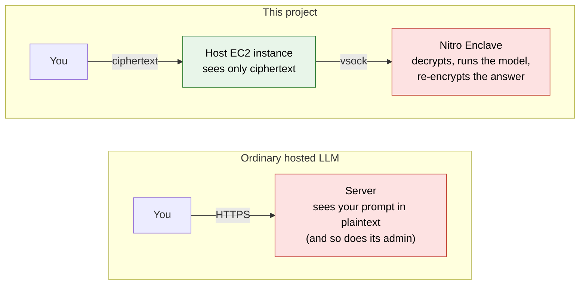
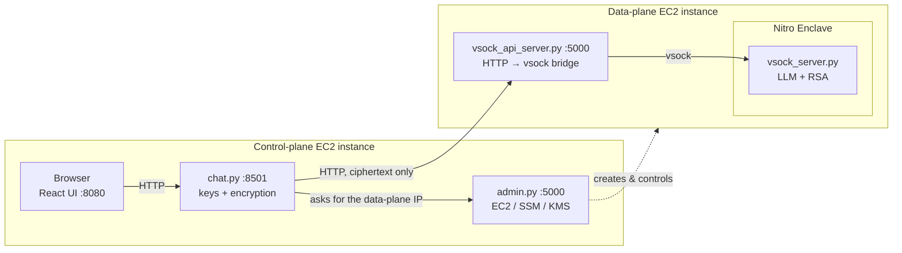
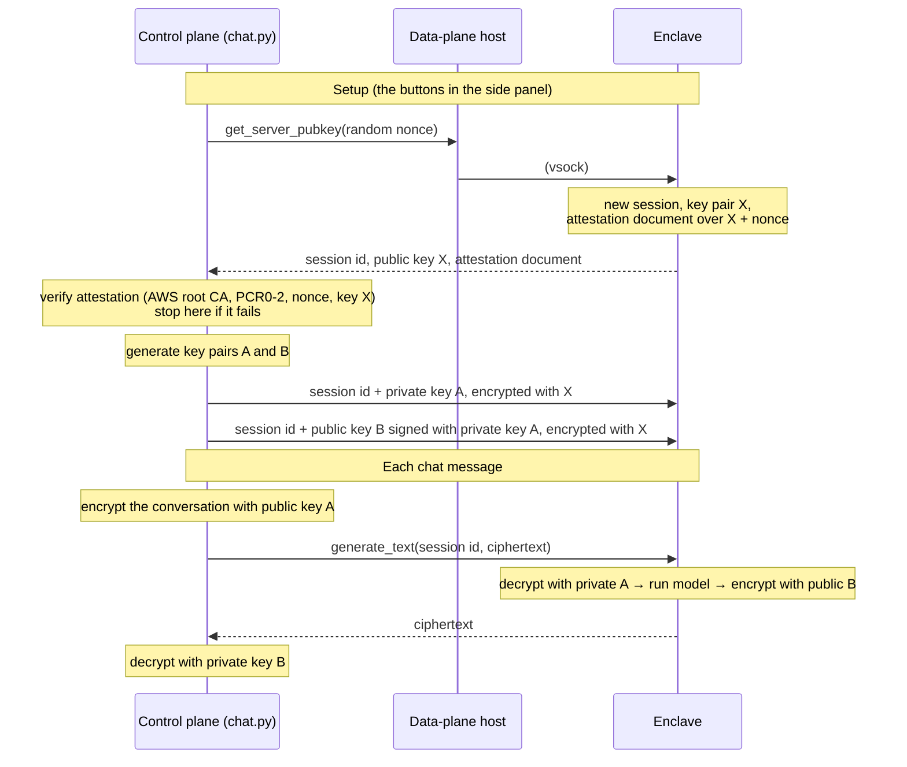

# Confidential LLM on AWS Nitro Enclaves

A chat app where the language model runs inside an **AWS Nitro Enclave**, a sealed-off part of a server that even the server's own administrator cannot look into. Your prompt is encrypted before it leaves the control plane and is only ever decrypted inside the enclave; the answer comes back the same way. The machine that hosts the model only ever sees ciphertext, and the control plane checks the enclave's signed attestation document before it hands over any key.

Default model: [Qwen2.5-0.5B-Instruct](https://huggingface.co/Qwen/Qwen2.5-0.5B-Instruct). The original prototype used GPT-2, which is still supported ([Model](#model)).


**Contents:** [The problem](#the-problem-this-solves) · [How it works](#how-it-works-in-one-minute) · [Architecture](#architecture) · [Keys](#the-keys-and-who-holds-them) · [Attestation](#attestation) · [Run locally](#run-it-locally-no-aws-needed) · [Deploy on AWS](#deploy-on-aws) · [Model](#model) · [Security & limitations](#security-model-and-known-limitations) · [Roadmap](#roadmap) · [Glossary](#glossary)

## The problem this solves

When you send a question to a hosted LLM, the company running the server can read it. Encryption "in transit" (HTTPS) protects the network hop, but the text is decrypted the moment it reaches the server, because the model needs plaintext to work on. Anyone with root access to that machine, or a compromised process on it, can read every prompt.

A **Trusted Execution Environment (TEE)** changes that. The model runs inside an isolated area whose memory is encrypted and which the host operating system cannot read or debug. On AWS this is a **Nitro Enclave**: a stripped-down VM carved out of an EC2 instance, with no network, no disk and no login, reachable only through a narrow local channel called **vsock**.



Red = plaintext exists here. In this project the only place the prompt is readable on the server side is inside the enclave.

## How it works in one minute

There are three machines (or, locally, three containers):

| | Name | Role | Can it read your prompt? |
|---|---|---|---|
| 1 | **Control plane** | The machine you talk to. Runs the chat website, verifies the enclave, creates the encryption keys, encrypts your prompt and decrypts the answer. | Yes, it is on your side of the trust boundary |
| 2 | **Data plane** | The EC2 host that owns the enclave. Only relays encrypted bytes into and out of the enclave. | **No** |
| 3 | **Enclave** | Runs inside the data plane. Holds the model, decrypts the prompt, generates, encrypts the answer. | Yes, but nothing outside it can see in |

Sending one message looks like this:

```mermaid
flowchart LR
    classDef plain fill:#fde2e2,stroke:#c0392b,color:#000
    classDef cipher fill:#e8f5e9,stroke:#2e7d32,color:#000
    classDef enc fill:#fff8e1,stroke:#f9a825,color:#000

    P["1. Your prompt<br/>(plaintext)"]:::plain --> E1["2. Encrypt with<br/>public key A"]:::enc
    E1 --> C1["3. Ciphertext travels<br/>through the data plane"]:::cipher
    C1 --> D1["4. Enclave decrypts<br/>with private key A"]:::plain
    D1 --> G["5. Model generates<br/>the answer"]:::plain
    G --> E2["6. Enclave encrypts<br/>with public key B"]:::enc
    E2 --> C2["7. Ciphertext travels<br/>back out"]:::cipher
    C2 --> D2["8. Control plane decrypts<br/>with private key B"]:::plain
```



The chat UI shows exactly these steps live in its "Message flow" panel, and prints the ciphertext of both the prompt and the answer so you can see that what crosses the data plane is unreadable. The model keeps no memory between requests, so each turn encrypts and sends the whole conversation so far as one payload; **New conversation** starts over. The "Message flow" panel is the same for every turn.

## Architecture



| Directory | Runs on | What it does |
|---|---|---|
| [`enclave/`](enclave/) | Inside the Nitro Enclave | `vsock_server.py` loads the model and answers four requests: `get_server_pubkey`, `send_encrypted_client_seckey_a`, `send_client_pubkey_b`, `generate_text`. `nsm.py` asks the Nitro Security Module (`/dev/nsm`) for the attestation document. `Dockerfile` becomes the enclave image (`.eif`). |
| [`data-plane/`](data-plane/) | Parent EC2 instance | `vsock_api_server.py` exposes those four requests over HTTP, behind a bearer token; `vsock_client.py` finds the enclave's address with `nitro-cli` and talks vsock. `scripts/ec2-setup.sh` prepares the host. |
| [`control-plane/api/`](control-plane/api/) | Control-plane EC2 instance | `admin.py`: create / start / stop / delete the data-plane instance, launch the enclave, create a KMS key, start the demo. `chat.py`: verify the enclave, generate keys, encrypt, decrypt, forward to the data plane. `attestation.py` verifies attestation documents; `auth.py` is the bearer / HTTP Basic auth shared by both apps; `tests/` covers the verifier. |
| [`control-plane/web/`](control-plane/web/) | Control-plane EC2 instance | React + Vite + shadcn/ui chat UI with the key-setup panel (including the attestation result) and the live message-flow view. |
| [`common/`](common/) | Everywhere | `utils.py`: length-prefixed framing (4 MiB cap) and chunked RSA-OAEP, shared by all three components (the Docker images copy it next to each script). `requirements-dev.txt`: pytest. |
| [`docker-compose.yml`](docker-compose.yml), [`scripts/`](scripts/) | Your laptop | Local mock mode and an end-to-end smoke test. |
| `tests/`, `.github/workflows/` | Your laptop, CI | Unit tests and the CI workflow. |

`python -m pytest` runs the unit tests; GitHub Actions runs them plus the web build and the docker-compose smoke test on every push.

## The keys, and who holds them

Everything is RSA-2048 with OAEP/SHA-256 (PyCryptodome). Three key pairs are involved. The enclave makes one; the control plane makes two and hands the enclave exactly the halves it needs.

| Key | Made by | Public half goes to | Private half stays with | Used for |
|---|---|---|---|---|
| **X** (enclave key) | Enclave, fresh each session | Control plane, inside a signed attestation document | Enclave | Wrapping private key A and public key B so only the enclave can read them |
| **A** (prompt key) | Control plane | Stays on control plane (encrypts prompts) | Sent to the **enclave**, encrypted with X | Prompt: control plane locks, enclave unlocks |
| **B** (response key) | Control plane | Sent to the **enclave**, encrypted with X and signed with A | Control plane | Answer: enclave locks, control plane unlocks |

Each `get_server_pubkey` opens a new **session** in the enclave with its own key X and returns a session id. Keys A and B, and every `generate_text`, carry that id, so they land in the session whose key X was attested. Each key can be set once per session: key A first, then key B, and a second attempt at either is refused. The enclave keeps at most 32 sessions and drops each after an hour without a request.



Why can the data plane not cheat? It never holds private key A (it only forwards it wrapped under X, and only the enclave has X's private half) and never holds private key B. It cannot swap in its own key B: public key X is public, so the host could wrap a key of its own under X, but the enclave only accepts a key B that carries a signature by the session's private key A, which the host never sees. Keys are also write-once per session, so the host cannot replace them after the client has sent them (in the UI, once keys have been sent the way to start over is **Delete all keys**, which opens a new enclave session). If it sends its own keys A' and B' first, the client's keys are refused (`chat.py` reports the error, or, if the host hides it, the first prompt fails), and a prompt the client encrypts under its real key A cannot be decrypted with A', so the model never runs on it. And it cannot pass off its own key X, because chat.py only accepts a key X that comes with a valid attestation document for the expected enclave image and the nonce it just generated.

## Attestation

When `chat.py` asks for key X it sends a fresh random 32-byte nonce. The enclave asks the Nitro Security Module for an **attestation document** containing public key X and that nonce. The document is a CBOR `COSE_Sign1` structure signed by a certificate that chains up to AWS; its payload holds the module id, a timestamp, the **PCR** measurements of the running image, the signing certificate and CA bundle, the public key and the nonce.

Before storing key X, `chat.py` checks ([`control-plane/api/attestation.py`](control-plane/api/attestation.py)):

- the certificate chain from the signing certificate through the CA bundle to the **AWS Nitro Enclaves root CA G1** embedded in `attestation.py` (SHA-256 fingerprint `64:1A:03:21:A3:E2:44:EF:E4:56:46:31:95:D6:06:31:7E:D7:CD:CC:3C:17:56:E0:98:93:F3:C6:8F:79:BB:5B`, as published at <https://docs.aws.amazon.com/enclaves/latest/user/verify-root.html>), including each certificate's validity period;
- the ES384 signature over the document;
- PCR0, PCR1 and PCR2 against the expected values;
- the nonce (so an old document cannot be replayed) and the public key (so it is the key X it received).

The result has one of four modes, plus two flags: `verified` (key X is proven to belong to the image you built) and `chain_valid` (signature, certificate chain to the AWS root, nonce and key X check out, PCRs aside). `scripts/smoke_test.py` prints all three, and the side panel shows the mode with PCR0–2 under *Get enclave public key*.

| Mode | When | `verified` | `chain_valid` | What it proves |
|---|---|---|---|---|
| `verified` | `ENCLAVE_DEBUG_MODE=false`, document valid and PCR0–2 equal `ENCLAVE_PCR0..2` | `true` | `true` | Key X belongs to an enclave running exactly the image you built |
| `debug` | `ENCLAVE_DEBUG_MODE=true` (the default), document valid with all-zero PCRs | `false` | `true` | Key X belongs to *some* debug-mode Nitro Enclave; it says nothing about which code it runs |
| `failed` | A document was checked and is invalid, and `REQUIRE_ATTESTATION=false` let the key through (`errors` lists why) | `false` | either | Nothing |
| `skipped` | No document (local mock) and `REQUIRE_ATTESTATION=false` | `false` | `false` | Nothing |

- `REQUIRE_ATTESTATION` (default `true`) fails closed: without a valid document, key X is not stored, the previous one is deleted (every *Get enclave public key* starts by deleting it), and the setup step fails, so keys A and B are never sent. A debug-mode document passes this check only while `ENCLAVE_DEBUG_MODE=true`, and is still reported with `verified=false`. Only the local compose file sets `REQUIRE_ATTESTATION=false`.
- `ENCLAVE_DEBUG_MODE` (default `true`) makes `admin.py` start the enclave with `--debug-mode` and makes `chat.py` expect all-zero PCRs. With `false`, `chat.py` requires `ENCLAVE_PCR0..2` to be set and to match.

**Status:** the verifier has unit tests that sign documents with a synthetic CA and check the embedded root certificate against AWS's published fingerprint. Neither `enclave/nsm.py` nor the verifier has yet been run against a document from real Nitro hardware.

## Run it locally (no AWS needed)

```sh
docker compose up --build        # first build downloads CPU torch + Qwen2.5-0.5B-Instruct (~1 GB), a few minutes
open http://localhost:8080       # click the key-setup buttons top to bottom, then chat
API_TOKEN=local-api-token python scripts/smoke_test.py    # or drive the whole flow from the terminal
```

Local mode runs the **same `vsock_server.py`** as a plain container, with `ENCLAVE_TRANSPORT=tcp` instead of vsock. The key exchange and encryption are identical to the Nitro deployment; what's missing is the hardware isolation and attestation. The enclave and data-plane containers aren't published to the host, so the browser only ever reaches `chat.py`, as in production.

- **Startup order.** Compose waits on health checks: enclave (model loaded, port 5000 open) → data-plane (`/health`) → chat (`/health`) → web. `docker compose ps` shows each as `(healthy)`.
- **Tokens.** Compose defaults to `API_TOKEN=local-api-token` (the web container gets the same value as `VITE_API_TOKEN`) and `DATA_PLANE_TOKEN=local-data-plane-token`. Override either from the shell or `.env`; `scripts/smoke_test.py` reads `API_TOKEN`, and `CHAT_URL` if `chat.py` is not at `http://localhost:8501/api`.
- **Local-only settings.** `REQUIRE_ATTESTATION=false` (no Nitro hardware, so no attestation document; the mode is `skipped`) and `ENCLAVE_LOG_PLAINTEXT=true`. Never use either in a deployment.
- **Upgrading from an older checkout.** `chat.py` now runs as an unprivileged user, and a `keys` volume from an older version holds root-owned files (`[Errno 13] Permission denied: '/data/keys/server_key.bin'`). Run `docker compose down -v` once.

`scripts/smoke_test.py` runs the key exchange and one encrypted chat turn against `chat.py`, and exits non-zero on any failure:

```
[ok] create key directory: Key directory created at /data/keys.
[ok] get enclave public key: Server public key retrieved and saved to server_key.bin.
      attestation: mode=skipped verified=False chain_valid=False pcr0=None
[ok] generate key A: Key key_a generated and saved.
[ok] generate key B: Key key_b generated and saved.
[ok] encrypt private key A with enclave key: Key A (private key) encrypted successfully.
[ok] send encrypted key A to enclave: Encrypted Key A sent to the TEE successfully.
[ok] send public key B to enclave: Key B (public) sent to the TEE successfully.
[ok] encrypt prompt with key A: 200
      ciphertext: G3KQ2ZJb5wzA6MW7be4QRltwucPkYzpDvA0jXeMfvO/gUYAH...
[ok] generate text inside enclave: 200
[ok] decrypt response with key B: 200

prompt:   In two sentences, what is a trusted execution environment?
response: A trusted execution environment ensures that software runs as intended and meets security standards.
[ok] delete all keys: All keys deleted successfully.
```

To see that the host really only relays ciphertext, compare the logs: `docker compose logs enclave` prints the decrypted prompt and answer (`Text prompt: ...`, `Generated text: ...`) because compose sets `ENCLAVE_LOG_PLAINTEXT=true` for this demo; `docker compose logs data-plane` shows only HTTP requests. A real enclave leaves that setting off (the default) and never prints plaintext.

## Deploy on AWS

You need an AWS account. Nitro Enclaves require a supported instance type (for example `m5.xlarge` or larger) with the enclave option turned on. **[docs/aws-setup.md](docs/aws-setup.md)** covers the IAM policies, security groups, enclave sizing, systemd units and troubleshooting.

### 1. Data plane: build the enclave image and an AMI

`admin.py` launches each data-plane instance from an AMI and only sends it commands over SSM, so build everything once on a template instance and save it as that AMI.

On an Amazon Linux 2023 EC2 instance with Nitro Enclaves enabled, from the repo root:

```sh
bash data-plane/scripts/ec2-setup.sh            # nitro-cli, docker, python3.11, 8 GiB enclave allocation (log out/in afterwards)
python3.11 -m venv ~/venv && source ~/venv/bin/activate
pip install -r enclave/requirements.in -r data-plane/requirements.txt   # the hash-locked enclave/requirements.txt is for the image build

python enclave/download_model.py Qwen/Qwen2.5-0.5B-Instruct enclave/model     # or: ... gpt2 enclave/model
docker build -f enclave/Dockerfile -t llm-enclave .                              # from the repo root
nitro-cli build-enclave --docker-uri llm-enclave:latest --output-file enclave/llm.eif   # note PCR0-2
```

- `python3.11`, not `python3`: AL2023's `python3` is 3.9 and the pinned dependencies need 3.10 or later.
- The build context is the repo root because the image copies `common/utils.py`.
- `build-enclave` prints PCR0, PCR1 and PCR2 (`nitro-cli describe-eif --eif-path enclave/llm.eif` shows them again). Put them in the control plane's `.env` as `ENCLAVE_PCR0..2` and set `ENCLAVE_DEBUG_MODE=false` for a verified deployment. They change whenever the image does (code, pinned versions, model, base image).

Then create an AMI from this instance and put its ID in `DATA_PLANE_AMI_ID` ([details](docs/aws-setup.md#build-the-data-plane-ami)).

### 2. Control plane

```sh
cp .env.example .env                            # fill in your own AWS values, tokens and PCRs
set -a; source .env; set +a

pip install -r control-plane/api/requirements.txt   # Python 3.10 or later
python control-plane/api/admin.py               # admin UI on :5000

cd control-plane/web && cp .env.example .env && npm ci   # set VITE_API_TOKEN here
```

Besides the AWS values, set these in `.env` (long random values, e.g. `openssl rand -hex 32`; an empty value disables that check with a warning at startup):

| Variable | Purpose |
|---|---|
| `ADMIN_USER`, `ADMIN_PASSWORD` | HTTP Basic auth on every `admin.py` route; `chat.py` uses the same pair to ask `admin.py` for the data-plane IP |
| `API_TOKEN` | Bearer token for `chat.py`'s `/api/*`; set `VITE_API_TOKEN` in `control-plane/web/.env` to the same value |
| `DATA_PLANE_TOKEN` | Bearer token between `chat.py` and `vsock_api_server.py`; `admin.py` passes it to the data plane in the SSM command |
| `ALLOWED_ORIGINS` | Browser origins `chat.py` accepts (CORS), default `http://localhost:8080` |
| `ENCLAVE_DEBUG_MODE`, `ENCLAVE_PCR0..2` | `false` plus the PCRs from step 1 for a verified deployment ([Attestation](#attestation)) |

Then open the admin UI and go through **Create instance → Start TEE → Start demo**. Starting the demo launches `vsock_api_server.py` on the data plane through SSM and waits until its `/health` answers, then starts `chat.py` and the React dev server locally and waits for each to be reachable, instead of sleeping for fixed times. If a component does not come up in time, the admin UI says which one.

All configuration is read from environment variables; [`.env.example`](.env.example) lists them.

## Model

The enclave loads whatever Hugging Face causal LM is in `MODEL_DIR` (see [`enclave/download_model.py`](enclave/download_model.py)). Instruction-tuned models are prompted through their chat template; base models such as GPT-2 are run as plain text continuation, so both work with the same server.

| Model | Params | Download | Notes |
|---|---|---|---|
| `Qwen/Qwen2.5-0.5B-Instruct` (default) | 0.5B | ~1 GB | Chat-tuned, Apache-2.0, answers questions properly |
| `HuggingFaceTB/SmolLM2-360M-Instruct` | 360M | ~720 MB | Smaller chat model |
| `distilgpt2` / `gpt2` | 82M / 124M | ~350 / ~550 MB | The original prototype's base model; continues text rather than answering |

```sh
ENCLAVE_MODEL=distilgpt2 docker compose up --build        # local mock with the original GPT-2
python enclave/download_model.py gpt2 enclave/model       # Nitro build with GPT-2
```

`MAX_NEW_TOKENS` (default 150) and `SYSTEM_PROMPT` tune generation. Replies from the 0.5B model take roughly 5–20 s on a laptop CPU. It is a small model: answers are coherent but can be shallow or wrong; the point of the demo is the confidentiality pipeline, not the model.

## Security model and known limitations

The **data-plane host OS and whoever administers it** never see prompts or responses in plaintext; only the enclave can decrypt them. With `ENCLAVE_DEBUG_MODE=false`, `REQUIRE_ATTESTATION=true` and all tokens set, the design also protects against:

- **A host that substitutes the enclave key.** Key X is only accepted with an attestation document that chains to the AWS root, matches PCR0–2 and contains the nonce `chat.py` just generated.
- **A host that swaps key B.** Public key B travels encrypted under X and signed with private key A, which the host never holds, and both keys are write-once per session, so the host cannot replace B with its own key and read every answer.
- **Forged frame sizes.** Every vsock frame starts with a length prefix; the enclave refuses anything over 4 MiB instead of allocating whatever the host claims.
- **Plaintext in the console.** The enclave does not print prompts or answers (its console is visible to the host in debug mode and ends up in SSM output) unless `ENCLAVE_LOG_PLAINTEXT=true`, which only `docker-compose.yml` sets.
- **Unauthenticated access.** `admin.py` requires HTTP Basic auth, and its state-changing (POST) requests also need an `X-Requested-With: XMLHttpRequest` header, which another site cannot send, so cached Basic credentials cannot be used for cross-site request forgery; `chat.py`'s API requires a bearer token and only accepts browser requests from `ALLOWED_ORIGINS`; the data-plane bridge requires its own bearer token. Only the `/health` endpoints are open.
- **Cross-session key clobbering.** Keys A and B live in the enclave session they were sent to, so a second client cannot overwrite another session's keys.

An enclave session expires after 1 h without a request; the next message then fails with "Unknown or expired session_id" and the keys have to be set up again. Every turn sends the whole conversation in one frame, so a very long conversation (about 1 MiB of text: RSA chunking and the wire encoding grow it past the 4 MiB frame cap) is refused; **New conversation** in the UI starts over with an empty history.

What it does not protect against, and what I would change next:

- **Plaintext exists on the control plane.** `chat.py` holds both private keys and does the encryption and decryption, and the browser sends plaintext to it. Moving key generation, attestation checks and encryption into the browser (WebCrypto) is the next step to make it truly client-to-enclave.
- **RSA in chunks** is slow and has no integrity protection across chunks. A hybrid RSA + AES-GCM scheme would fix both.
- **Unusual use of key A.** The prompt is encrypted with public key A, and the enclave gets private key A. A simpler and more conventional design: send the enclave an ephemeral AES-GCM session key, wrapped with key X.
- **Single-tenant admin state.** `admin.py` tracks one data-plane instance in process memory, and `chat.py` keeps one set of keys on disk.
- **`DATA_PLANE_TOKEN` is visible in SSM.** `admin.py` puts it on the command line of the SSM command that starts the bridge, so it shows up in SSM command history. That command also runs under `AWS-RunShellScript`, whose default 3600 s timeout can stop the long-running bridge; a systemd unit on the data plane avoids that ([details](docs/aws-setup.md#the-data-plane-bridge-and-ssm)).
- **Attestation is not hardware-tested.** See [Attestation](#attestation). `admin.py` also creates a KMS key whose policy requires matching PCRs, but nothing uses it yet.
- **PCR0 reproducibility is not demonstrated.** Direct Python dependencies are pinned to exact versions, base images are pinned by digest and `dnf update` is gone from the enclave image, but nobody has yet shown that two builds produce the same PCR0. Rebuild and compare with `nitro-cli describe-eif` before relying on it.
- **Debug mode.** By default (`ENCLAVE_DEBUG_MODE=true`) the enclave runs with `--debug-mode`, which zeroes the PCRs and allows console access. Attestation then only checks that the PCRs are zero, which every debug-mode enclave satisfies. Set `ENCLAVE_DEBUG_MODE=false` and the real PCRs for anything beyond a demo.

`enclave/run.sh` is the enclave image's entrypoint. It brings up the loopback interface, starts `traffic_forwarder.py` (from the AWS sample: forwards `127.0.0.1:443` inside the enclave over vsock to a `vsock-proxy` on the parent, allowlisted in `vsock-proxy.yaml`) and then `vsock_server.py`. The model server makes no outbound connections, and nothing on the parent starts that proxy.

## Roadmap

Beyond the fixes above, the longer-term direction is a managed service where customers get a ready-made, enclave-backed data plane to build on:

- **Streaming responses.** Send the answer as it is generated, which needs a protocol of chunked, individually encrypted frames.
- **Scalable data plane.** Run several data-plane instances behind a load balancer and scale them with demand, for example with EKS or EC2 Auto Scaling (a minimum of 2 instances, a maximum of 10).
- **Authentication and roles** instead of shared tokens and IP allowlisting. For example, Amazon Cognito with three roles: *user* (chats), *tenant admin* (sets scaling limits for their organization) and *operator* (runs the whole service).
- **Disposable infrastructure.** Data-plane instances are already created and deleted on demand. The next step is to bootstrap them from user data instead of a pre-built AMI.
- **Swappable models and workloads.** Choosing the model at runtime, and eventually running any customer-supplied container image inside the enclave.

## Glossary

- **TEE (Trusted Execution Environment)**: a hardware-isolated area of a machine where code and data are protected from the rest of the system, including the OS and its administrators.
- **Nitro Enclave**: AWS's TEE. A small VM split off from an EC2 instance, with no network, persistent storage or interactive access.
- **vsock**: the only communication channel into an enclave: a local socket between the parent instance and the enclave, addressed by a *CID* instead of an IP.
- **Attestation**: a signed document the enclave can produce proving *which* code it is running (via the **PCR** measurements). Lets a remote party verify an enclave before trusting it. `chat.py` verifies it before accepting key X ([Attestation](#attestation)).
- **Nonce**: a random value used once. Putting it in the attestation document proves the document was made for this request.
- **PCR0–2**: hashes of the enclave image, kernel and application. All zero when an enclave runs in debug mode.
- **KMS**: AWS Key Management Service. Its key policies can require a matching attestation, so only a specific enclave image can decrypt.
- **Control plane / data plane**: the machine you interact with and that orchestrates the system, versus the machine that does the actual (confidential) work.
- **Public / private key**: anything locked with a public key can only be unlocked with its matching private key. Public keys can be shared freely; private keys must not be.

## Tech stack

Python · Flask · PyTorch · Hugging Face Transformers · PyCryptodome · cbor2 · cryptography · pytest · AWS Nitro Enclaves · EC2 · SSM · KMS · boto3 · React · TypeScript · Vite · Tailwind · shadcn/ui · Docker Compose · GitHub Actions

## License

Licensed under the [Apache License 2.0](LICENSE).
